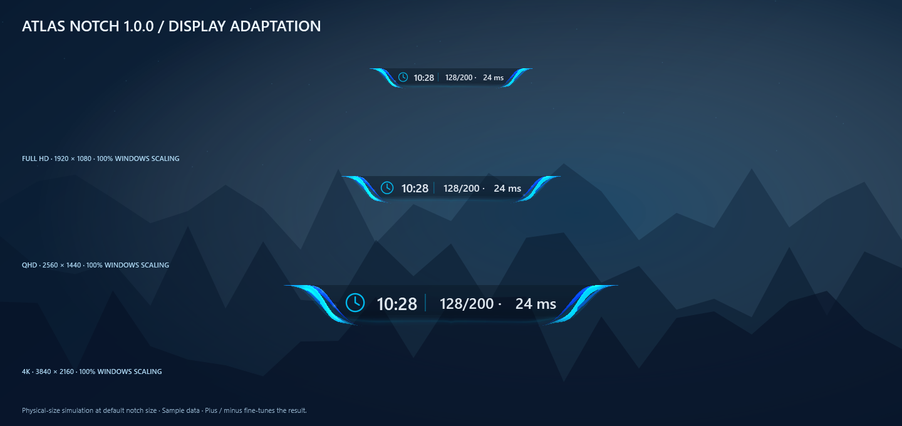
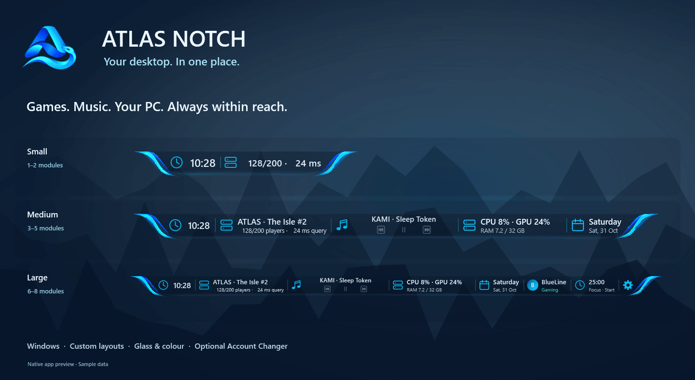
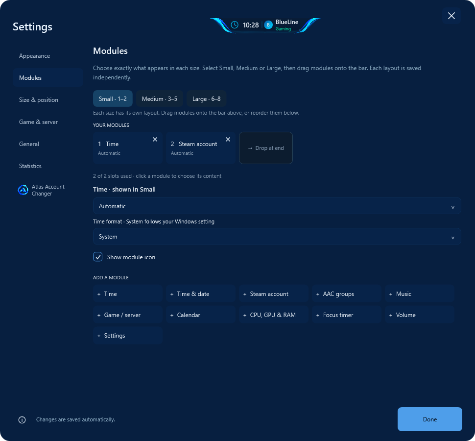

# ATLAS Notch

**Your games, music and essentials — one glance away.**

A compact Windows bar with flowing blue and cyan ribbons, a glass surface and layouts that grow with you. Keep the information you want at the screen edge, without filling your desktop with separate widgets.

## Make the space yours

- **Three independent layouts.** Small: 1–2 modules. Medium: 3–5. Large: 6–8. Choose the content, reorder modules and keep a different arrangement for each size.
- **Game and server information.** Recognise supported Steam and other launcher games. Show the exact server's player count and measured latency when the game and server expose enough information. If server details are unavailable, keep the game name visible.
- **Music within reach.** See the current title and artist above accessible playback controls, using Windows media sessions.
- **CPU, GPU and RAM.** Keep an eye on usage with stable numeric spacing.
- **Your everyday essentials.** Local time, 12/24-hour formats, date, calendar, volume and a focus timer.
- **Local playtime statistics.** Browse time spent in games and on identified servers, sort the results and reset them when you choose.
- **Optional Atlas Account Changer integration.** With a compatible AAC Bridge v4, view shared groups, display names and avatars, request a switch and see its progress. AAC performs and confirms the switch. Login names and credentials are not supplied to Notch.

## Built to feel at home

Customise colour, transparency and motion. Dock at the top or bottom, choose a display and position, enable Windows startup, or let Notch slide away while no game is running. Flowing ribbon strands, changing highlights and subtle glints keep the original blue/cyan look alive.

Optional player-count trends and separate player/ping rise warnings let you choose what matters. Warnings appear briefly without changing the bar's size. Settings save automatically.

## Get ATLAS Notch

**USD $1.99 · one-time purchase.** The first-install package will be available through our sales page.

<!-- PURCHASE_URL: intentionally empty until the Fourthwall product link is supplied. -->

Already own Notch? This repository is the official update channel. It contains product information and **update-only packages**, not the first-install sales package or application source code.

## Updates that stay simple

From version 1.0, Notch checks the official channel automatically, verifies the publisher signature and downloaded file, then closes, updates and restarts. Your saved settings and playtime remain. No GitHub account or release-address entry is needed.

**Moving from the beta?** Existing betas were built before this channel was configured. Run the [1.0 update package](https://github.com/BluelineDE/atlas-notch/releases) once with Notch installed. Later updates are handled by Notch. An update-only package refuses a missing or invalid main installation.

Release 1.0 starts without patch notes. Later updates can show their changes once after updating.

## Good to know

- Windows x64. Music depends on the media session exposed by your player.
- Exact server information depends on the game, server protocol, reachable status endpoint and network permission. Private Minecraft Java servers can provide status/player counts when their status service is reachable and enabled; universal detection or access to protected servers is not promised.
- Query/ICMP latency is a measured network/status round trip and can differ from the game's own ping.
- Some server detection uses the optional protected ATLAS network service, enabled with one Windows administrator approval. Notch does not need Steam passwords.
- Settings and playtime are stored locally, encrypted for the current Windows user. Backup retention is limited to five encrypted backups.
- Screenshots and animations show the native app using clearly isolated sample data.

Made by **BlueLineDE**. ATLAS Notch is proprietary software; this repository does not grant an application source-code licence.
