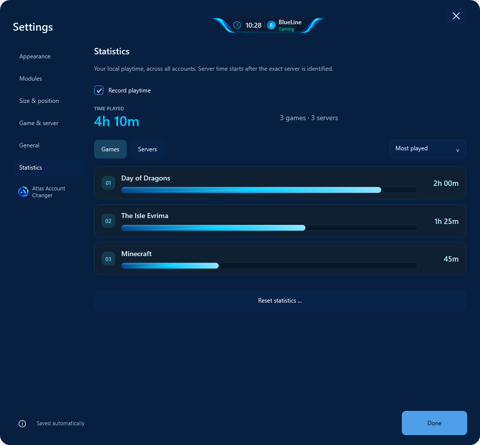

# ATLAS Notch

### Your desktop. In one place.

ATLAS Notch is a compact, customisable bar for Windows that brings your games, music and everyday information to the edge of your screen. A glance shows what matters. A click opens more space.

Flowing blue and cyan ribbons, a glass surface, moving highlights and subtle glints make it feel alive — while your desktop stays yours.

## Small when you want it. More when you need it.

Keep just your essentials visible, or expand for music controls, game information and PC stats. Build a different layout for each size and arrange your modules in the order that feels right.

**Small · 1–2 modules &nbsp; | &nbsp; Medium · 3–5 modules &nbsp; | &nbsp; Large · 6–8 modules**

## What can your Notch do?

- **Stay with your game.** See supported Steam and other launcher games, with player count and measured latency when their server information is available. When only the game is identified, its name stays visible.
- **Keep your music close.** See the track and artist, then pause, play or skip with controls directly in the bar. Notch uses your player's Windows media session.
- **Watch your PC.** See CPU, GPU and RAM usage with steady spacing that keeps the bar calm as the numbers change.
- **Keep the essentials handy.** Add local time, a 12/24-hour clock, date, calendar, volume or a focus timer.
- **See where your time goes.** Browse your local game and server playtime, sort the results and reset your statistics whenever you want.
- **Choose your signals.** Enable player-count trends or separate player/ping rise warnings. Brief red indicators draw attention without changing the bar's size.

## Make it feel like your desktop

Choose your colours and glass transparency. Place Notch at the top or bottom of the display, adjust its position and choose your preferred size. Set it to start with Windows, or slide out of view while no game is running and return when a game is detected.

Module changes save automatically. Notch also handles official updates, keeping your saved settings and playtime with you.

## Get ATLAS Notch

**USD $1.99 · one-time purchase**

**[Get ATLAS Notch →](https://bluelinede-shop.fourthwall.com/en-eur#top)**

## Optional: Atlas Account Changer

Want to switch Steam accounts from your Notch? Add **[Atlas Account Changer →](https://github.com/BluelineDE/atlas-account-changer)**, a separate optional ATLAS app.

With a compatible AAC Bridge v4, Notch shows your shared account groups, display names and avatars. Choose an account and see the switch progress beside it; AAC performs and confirms the switch. Login names and credentials stay with AAC. You can also use Notch independently.

## A few practical details

Windows x64. Music controls depend on the media session exposed by your player. Exact server details depend on the game, the server's reachable status service and network permission; status-query or ICMP latency can differ from the game's own ping. Private Minecraft Java servers can supply status/player counts when their status service is reachable and enabled.

Some automatic server detection uses the protected ATLAS network service, enabled with one Windows administrator approval. Settings and playtime are stored locally, encrypted for the current Windows user, with up to five encrypted backups.

Images and animations show native Notch components with sample data.
